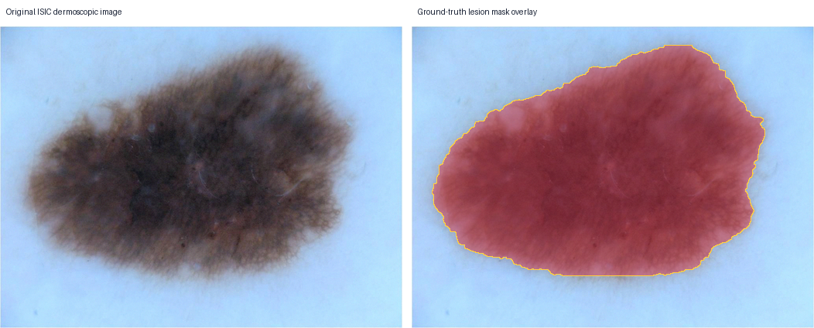

<div align="center">

# DERMA

### **D**ermoscopic **E**valuation of **R**egion **M**asks and **A**lgorithms

<a href="https://muhammad0isah.github.io/DERMA/" target="_blank" rel="noopener noreferrer"></a> [](https://challenge.isic-archive.com/data/) [](LICENSE) [](.github/workflows/score_submission.yml) [](encryption/)

</div>

## Overview

**DERMA** is a semantic-segmentation coding benchmark for comparing human and
LLM solutions on dermoscopic skin-lesion images.

**Task:** binary semantic segmentation  
**Metric:** mean foreground F1 score (Dice)  
**Data:** full ISIC 2016 Task 1 release — 900 train / 379 test images  
**Leaderboard:** [live page](https://muhammad0isah.github.io/DERMA/) · [CSV](docs/leaderboard.csv)

---

## Dataset

DERMA retains all official images, all masks, and the original train/test split.
Images receive reproducible mild RGB Gaussian noise (seed 25, sigma 3/255).
Training masks are unchanged. Your test predictions must be 0/255 grayscale PNG
masks at each image's native dimensions.

The original data is [ISIC 2016 Task 1](https://challenge.isic-archive.com/data/),
released under CC0.

### Annotation example



The left panel is an official training image. The right panel overlays its
ground-truth lesion mask in red, with a yellow boundary, to show the target
for semantic segmentation.

---

## Download the dataset

Run the following commands to download and prepare ISIC 2016 Task 1:

```bash
python scripts/download_data.py --download --output evaluation-private/source
python scripts/prepare_data.py \
  --train-images evaluation-private/source/ISBI2016_ISIC_Part1_Training_Data.zip \
  --train-masks evaluation-private/source/ISBI2016_ISIC_Part1_Training_GroundTruth.zip \
  --test-images evaluation-private/source/ISBI2016_ISIC_Part1_Test_Data.zip \
  --test-masks evaluation-private/source/ISBI2016_ISIC_Part1_Test_GroundTruth.zip \
  --output-root .
```

Use `data/public/` for training and prediction.

---

## Repository Structure

```
DERMA/
├── data/public/                 # training images/masks and test images
├── encryption/
│   ├── public_key.pem           # use this to encrypt submissions
│   └── encrypt.py
├── competition/                 # validation, scoring and leaderboard code
├── baseline.py                  # GridGNN-UNet baseline
├── submissions/
│   └── <team>/                  # your encrypted prediction + metadata
└── leaderboard/
    └── leaderboard.csv          # automatically updated scores
```

---

## How to Participate

### 1. Install

```bash
pip install -r requirements.txt
```

### 2. Train and predict

Train a GNN method using every image in `data/public/train/`. The supplied
GridGNN-UNet baseline writes a valid prediction ZIP:

```bash
python baseline.py --data data/public --output outputs/predictions.zip
```

The ZIP contains `manifest.json` plus one `masks/<image_id>.png` file for
every test image. Use 0 for background and 255 for lesion.

### 3. Encrypt

```bash
mkdir -p submissions/YOUR_TEAM_NAME
python -m encryption.encrypt outputs/predictions.zip submissions/YOUR_TEAM_NAME/submission.enc
```

Create `submissions/YOUR_TEAM_NAME/meta.json`:

```json
{
  "team": "YOUR_TEAM_NAME",
  "model": "My GNN segmenter",
  "type": "human",
  "notes": "Short description"
}
```

### 4. Open a pull request

```
submissions/<team>/
├── submission.enc
└── meta.json
```

Commit only those two files and open a PR. The workflow decrypts, validates,
scores and publishes your result automatically.

---

## Rules

- One valid submission per team. The `team` field inside `meta.json` must match the folder name.
- Only GNN-based methods are eligible.
- Submit encrypted predictions only.
- CPU only: maximum 4 threads and 3 hours total training/prediction time.
- Train only with the released training data; do not use test masks or external pretrained weights.

---

## Baseline

`baseline.py` uses GridGNN-UNet: a U-Net with two learned four-neighbour graph
message-passing layers at its bottleneck. It is trained from scratch on all 900
training images and predicts all 379 test images on CPU.

---

## License

Competition code is MIT. ISIC 2016 Task 1 data is CC0.

## Citation

```bibtex
@misc{derma_2026,
  title={DERMA: Dermoscopic Evaluation of Region Masks and Algorithms},
  author={Muhammad Ibrahim Isah},
  year={2026}
}
```
